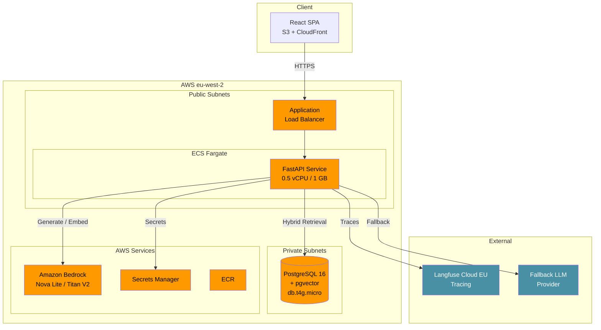

# RAG Platform

Production-grade multi-collection RAG platform on AWS demonstrating end-to-end AI system operation: infrastructure as code, eval-gated CI/CD, licence-aware retrieval, tracing, and cost visibility.

**Author:** Miles Waite  
**Status:** Phase 0 (Foundations)

## Architecture



## Collections

The platform serves multiple document collections with a UI selector:

| Collection | Status | Sources | Description |
|------------|--------|---------|-------------|
| **Complex Systems** | Phase 1 | 46 verified | Academic papers, textbooks, lecture notes on complexity science |
| **UK Tax** | Phase 5 | 22 verified (draft) | GOV.UK guidance on VAT, MTD, IR35 |

Each collection has its own:
- Source registry with licence metadata
- Golden evaluation set (~100-120 questions)
- System prompts and configuration
- CI gate thresholds

## Licence-Aware Retrieval

All sources are classified by licence for legal compliance:

| Class | Licence Types | API Behaviour |
|-------|---------------|---------------|
| **A** | CC BY, CC0, OGL, MIT | Full text with attribution |
| **B** | CC BY-NC-SA | Full text while app is non-commercial; flagged |
| **C** | arXiv non-exclusive, All Rights Reserved | ≤300 char excerpt + link; never serve full chunks |

The response composer enforces these rules automatically:
- Class C text is used for retrieval/grounding but output is capped
- N-gram overlap detection prevents excessive quoting
- Every response includes proper attribution and source links
- A `commercial` flag in Terraform flips Class B → C behaviour if needed

## Tech Stack

| Component | Choice | Rationale |
|-----------|--------|-----------|
| **Compute** | ECS Fargate (ARM/Graviton) | No cold starts, SSE streaming, ~$17/mo vs ~$37+ with NAT for Lambda |
| **Database** | RDS PostgreSQL 16 + pgvector | ~$16/mo vs ~$400/mo OpenSearch Serverless floor |
| **LLM** | Amazon Bedrock (Nova Lite) | ~$0.0005/query, with routing to stronger tiers |
| **Embeddings** | Titan Text Embeddings V2 | 1024-d, $0.0001/1K tokens |
| **Retrieval** | Hybrid (FTS + HNSW + RRF + reranker) | Exact token matching for maths/tax codes |
| **IaC** | Terraform | Remote state in S3, GitHub OIDC, no stored keys |
| **Tracing** | Langfuse Cloud EU | Free hobby tier, 50K units/mo |
| **CI/CD** | GitHub Actions | Eval gates per collection before deploy |

## Project Structure

```
rag-platform/
├── app/                      # FastAPI service
├── ingest/                   # Document ingestion pipeline
├── evals/                    # Golden sets, metrics, gates
├── collections/              # Per-collection config and sources
│   ├── complex-systems/
│   └── uk-tax/
├── terraform/
│   ├── bootstrap/            # One-time setup (CloudShell)
│   ├── envs/prod/            # Production environment
│   └── modules/              # Reusable modules
├── docs/                     # Build plan, source lists, ADRs
└── .github/workflows/        # CI/CD pipelines
```

## Roadmap

### Phase 0: Foundations ✅
- [x] Repo scaffold and documentation
- [x] Terraform bootstrap (S3 state, OIDC, IAM roles, Budget)
- [x] VPC skeleton (no NAT)
- [x] GitHub Actions CI/CD
- [x] Pre-commit hooks

### Phase 1: Complex Systems Ingestion
- [ ] Source registry from verified list
- [ ] Fetchers (arXiv, PDF, HTML)
- [ ] Licence engine and validators
- [ ] Chunking and embedding pipeline

### Phase 2: Retrieval + API + v1 Live
- [ ] Hybrid retrieval with RRF
- [ ] FastAPI service with SSE
- [ ] Response composer with licence enforcement
- [ ] Minimal UI with collection selector
- [ ] Deploy to production

### Phase 3: Evals and CI Gates
- [ ] Complex Systems golden set (~120 questions)
- [ ] Eval harness with LLM judge
- [ ] CI gates blocking failed releases
- [ ] Public /evals and /costs pages

### Phase 4: Hardening
- [ ] Threat model controls
- [ ] Autoscaling and alarms
- [ ] Load testing

### Phase 5: UK Tax Collection
- [ ] Complete source list (25-40)
- [ ] GOV.UK-specific ingester
- [ ] UK Tax golden set and gates

### Phase 6: Public Launch
- [ ] Demo video and write-up
- [ ] Security review
- [ ] Privacy notice

## Estimated Monthly Cost (v1 prod)

| Service | Estimate |
|---------|----------|
| ECS Fargate (0.5 vCPU, 1 GB ARM) | $17 |
| Application Load Balancer | $25 |
| Public IPv4 addresses | $11 |
| RDS db.t4g.micro + 20 GB | $16 |
| Secrets Manager (4 secrets) | $2 |
| Bedrock (3,000 queries/mo) | $2 |
| **Total** | **~$70-80/mo** |

## Getting Started

### Prerequisites

- AWS account with appropriate permissions
- Terraform >= 1.10.0 (required for S3 lockfile support)
- GitHub repository with Actions enabled

### Bootstrap (One-Time)

Run in AWS CloudShell with administrator access. CloudShell's bundled Terraform may be outdated, so install the required version first:

```bash
# Install Terraform 1.17.2 into ~/bin
mkdir -p ~/bin
curl -fsSL https://releases.hashicorp.com/terraform/1.17.2/terraform_1.17.2_linux_amd64.zip -o /tmp/terraform.zip
unzip -o /tmp/terraform.zip -d ~/bin
rm /tmp/terraform.zip
export PATH="$HOME/bin:$PATH"
terraform version  # Should show: Terraform v1.17.2

# Clone and apply bootstrap
git clone https://github.com/WaiteM124/rag-platform.git
cd rag-platform/terraform/bootstrap
terraform init
terraform plan -var="alert_email=your-email@example.com"
terraform apply -var="alert_email=your-email@example.com"
terraform output
```

### Configure GitHub (Required)

#### 1. Create the `production` Environment

The apply role trusts only the `production` GitHub environment:

1. Go to: **GitHub repo → Settings → Environments → New environment**
2. Name: `production`
3. Configure protection rules:
   - **Deployment branches**: Select "Selected branches" → Add `main`
   - **Required reviewers** (optional): Add reviewers for manual approval
4. Click **Save protection rules**

#### 2. Set Repository Variables

Go to: **GitHub repo → Settings → Secrets and variables → Actions → Variables**

| Variable | Value |
|----------|-------|
| `AWS_REGION` | `eu-west-2` |
| `TF_STATE_BUCKET` | `terraform output state_bucket_name` |
| `AWS_PLAN_ROLE_ARN` | `terraform output plan_role_arn` |
| `AWS_APPLY_ROLE_ARN` | `terraform output apply_role_arn` |

### Development

```bash
# Install pre-commit hooks
pre-commit install

# Format and validate Terraform
make fmt
make validate

# Run linting
make lint

# Plan changes
make plan ENV=prod
```

## Security

- **No secrets in repo**: All credentials in AWS Secrets Manager
- **OIDC authentication**: No long-lived AWS keys in GitHub
- **Least-privilege CI roles**:
  - Plan role trusts only `pull_request` events
  - Apply role trusts only `environment:production` (requires GitHub environment)
  - IAM writes scoped to `rag-platform-*` resources only
  - Self-modification explicitly denied (roles cannot modify themselves)
  - `iam:PassRole` restricted to ECS tasks only
- **Licence compliance**: Automated enforcement of source licences
- **Input validation**: Rate limits, size caps, spend caps
- **Tracing**: Full observability via Langfuse

See `docs/build-plan.md` §7 for the full threat model.

## Licence

MIT License - see [LICENSE](LICENSE)

Copyright (c) 2026 Miles Waite
