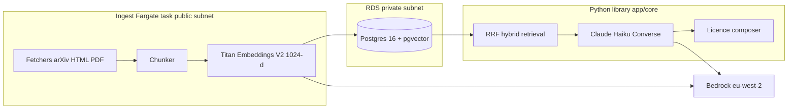

# Phase 1 architecture (RAG core)

Phase 1 delivers ingest → pgvector → hybrid retrieval → Bedrock answer → eval gates. No public API, ALB, UI, or Langfuse yet.

## Embeddings

Default embedding model: `amazon.titan-embed-text-v2:0` (1024 dimensions). Documented on [Amazon Bedrock model list](https://docs.aws.amazon.com/bedrock/latest/userguide/models-supported.html) for European regions; verify in-account while AWS seller verification completes. Fallback in code: set `RAG_EMBEDDING_MODEL_ID=cohere.embed-english-v3` (not default).