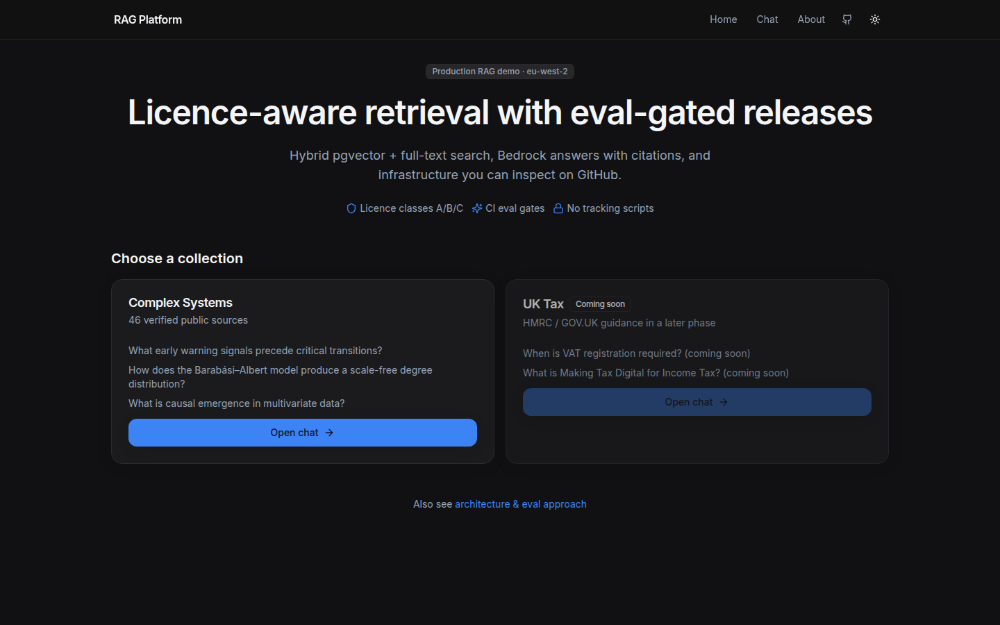
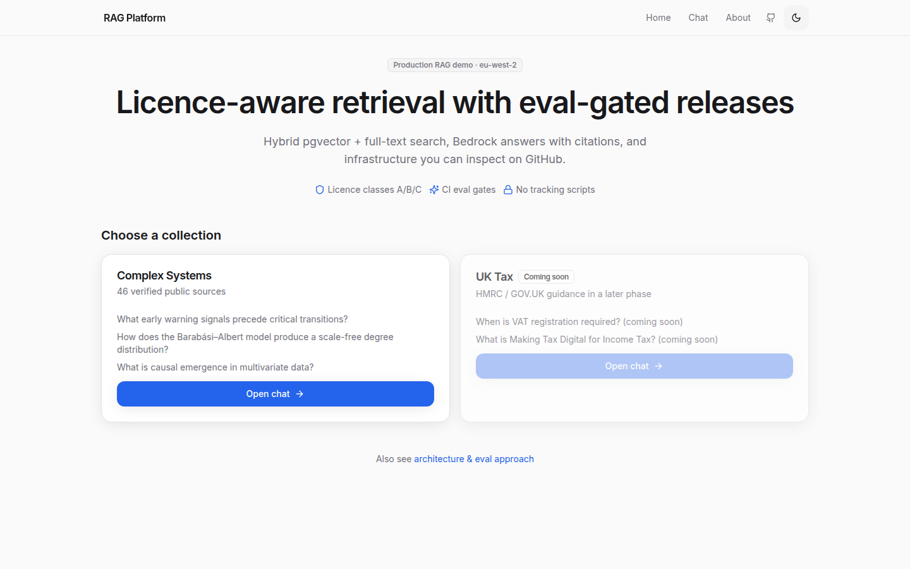

# Phase 2 deploy: rag.mileswaite.net

## UI preview

Portfolio-grade React UI (Tailwind + Radix/shadcn-style components, self-hosted Inter, dark-first with light toggle). Strict CSP — no CDN assets.

| Dark (default) | Light |
| --- | --- |
|  |  |

DNS is on **Cloudflare** (manual). Terraform does **not** create Route 53 records.

## Database migrations

On every ECS task start, FastAPI **startup** runs `ingest.migrations.runner.run_migrations` (idempotent: `001_init.sql`, `002_daily_spend.sql`, etc.). The web service uses the same `ecs-tasks-sg` as ingest, and **RDS** allows PostgreSQL from that security group only.

**Deploy order:** merge → Terraform Apply on `main` → Deploy Web workflow (triggered by any successful **Terraform** workflow run on `main`, with no path filter—infra-only applies still deploy; or use `workflow_dispatch`). The deploy job skips with a notice if the ECS web service is not `ACTIVE` yet.

After Terraform publishes a new web task definition revision, the deploy job calls `update-service` with task family `rag-platform-prod-web` (latest ACTIVE revision) because the ECS service ignores `task_definition` changes in Terraform state.

## Networking (verified)

- **ALB → tasks:** `ecs-tasks-sg` ingress on **8000/tcp** from `alb-sg` only.
- **ALB egress:** all traffic (includes **8000** to task ENIs).
- **Tasks → RDS:** `rds-sg` ingress on **5432/tcp** from `ecs-tasks-sg`.

## HTTPS

**Current default:** `enable_https = true` in prod (`terraform/envs/prod/variables_web.tf`). ACM for `rag.mileswaite.net` is **Issued** and Cloudflare DNS targets the ALB.

On apply:

- HTTPS listener on **443** with `ELBSecurityPolicy-TLS13-1-2-2021-06`
- HTTP **301** redirect to HTTPS
- ECS env `HTTPS_ENABLED=true`

### First-time bootstrap (before cert is issued)

1. Set `enable_https = false` and apply — ALB, ECS, ACM (pending validation). Use outputs `alb_dns_name`, `acm_validation_record_name`, `acm_validation_record_value`.
2. In Cloudflare: ACM validation CNAME, then `rag` → `alb_dns_name`. Wait until ACM is **Issued**.
3. Set `enable_https = true` and apply again (or rely on the default once issued).

## Langfuse

Secret `rag-platform/langfuse` is created with empty JSON keys. After adding real keys in Secrets Manager, restart the ECS service (or redeploy). The app enables tracing only when both keys are non-empty.